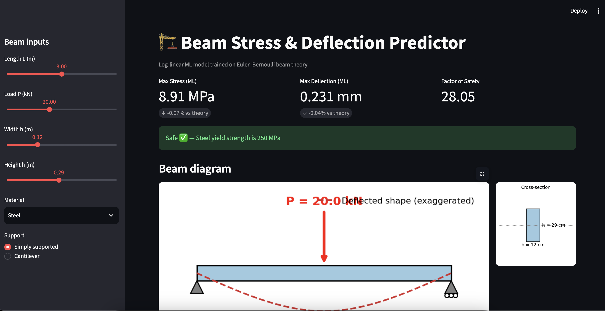
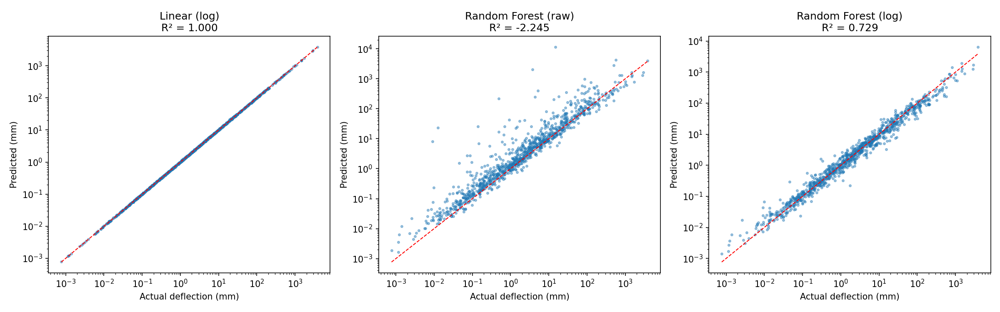

# 🏗️ Beam Stress & Deflection Prediction using ML

Predicting maximum bending stress and deflection of beams with machine learning, and showing that a **physics-informed log-linear model rediscovers Euler–Bernoulli beam theory** from data alone.



## Problem
Given a rectangular beam's length, load, width, height, material and support type (simply supported or cantilever), predict:
- Maximum bending stress σ = M·c / I
- Maximum deflection δ = PL³ / (k·E·I)

## Dataset
5000 beams generated from Euler–Bernoulli theory with 2% Gaussian noise to mimic real measurements.

| Parameter | Range |
|---|---|
| Length | 1 – 5 m |
| Load | 1 – 50 kN |
| Width × Height | 0.05–0.3 m × 0.1–0.5 m |
| Material | Steel, Aluminium, Timber |

## Key Insight
Beam physics is multiplicative (power law), so raw features correlate weakly with the outputs. A **log transform** makes the relationship linear:

log σ = log k + log P + log L − log b − 2·log h

## Results

**Stress**
| Model | R² | MAPE |
|---|---|---|
| Linear Regression (raw) | 0.461 | 1385% |
| Random Forest (raw) | 0.943 | 19.8% |
| **Linear Regression (log)** | **0.9995** | **1.58%** |

**Deflection**
| Model | R² | MAPE |
|---|---|---|
| Random Forest (raw) | −2.245 | 613% |
| Random Forest (log) | 0.729 | 32.9% |
| **Linear Regression (log)** | **0.9997** | **1.61%** |

The log-linear model reaches the **noise floor** (~1.6% for 2% noise).

### Learned coefficients vs theory (deflection)
| Feature | Learned | Theory |
|---|---|---|
| log L | 3.000 | 3 |
| log P | 1.001 | 1 |
| log b | −1.000 | −1 |
| log h | −2.999 | −3 |
| log E | −1.000 | −1 |
| cantilever | 2.774 | ln(16) = 2.773 |



**Takeaway:** physics-informed features with a simple model beat a black-box model, both in accuracy and in interpretability.

## Streamlit App
Interactive beam diagram, shear force / bending moment / deflection diagrams, stress-vs-load curve and a factor-of-safety check.

```bash
pip install -r requirements.txt
streamlit run app.py
```

## Tech Stack
Python, NumPy, Pandas, Scikit-Learn, Matplotlib, Seaborn, Streamlit